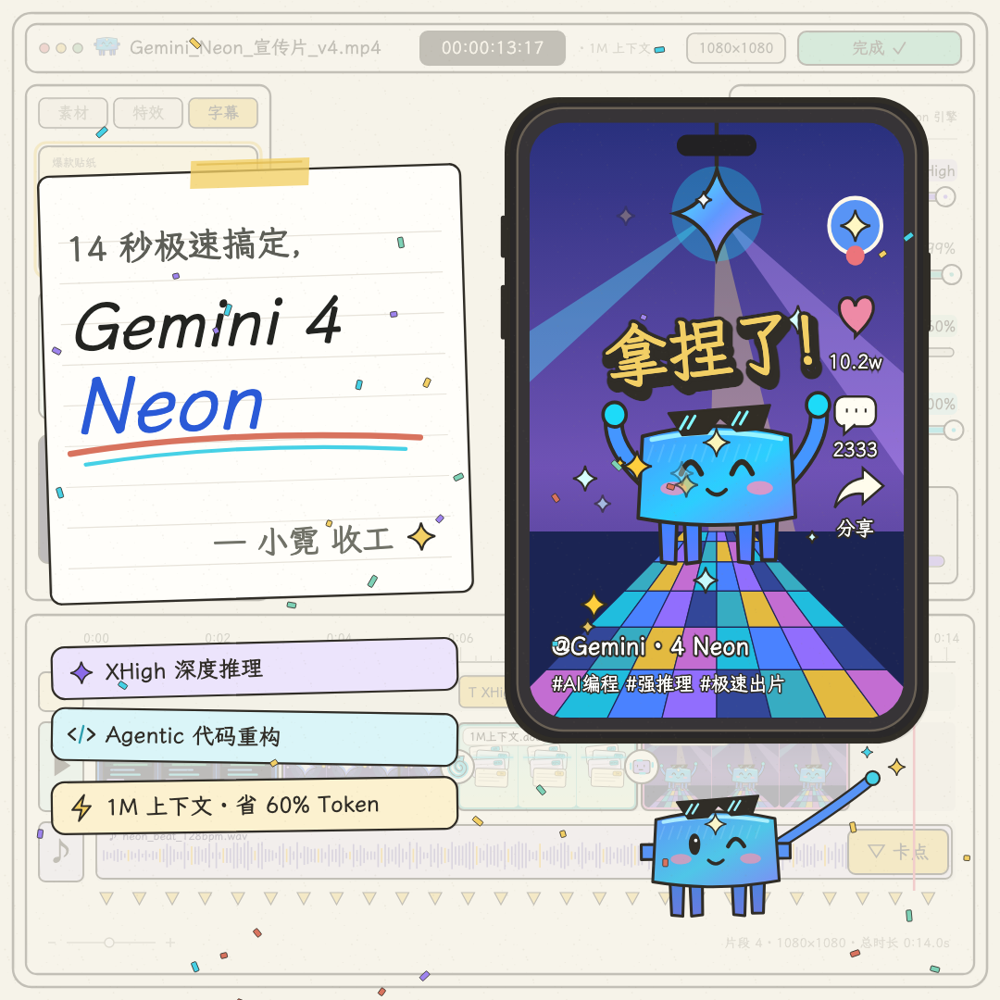

# Gemini 4 Neon · 1080×1080 手绘动效宣传短片

奶油纸感手绘剪辑工坊风格的 **1080×1080、14.0 秒（30fps / 420 帧）** Gemini 4 Neon 宣传短片工程，含 128 BPM 原创合成配乐与逐帧卡点拟音。



## 预览与渲染

### 1. 准备字体（霞鹜文楷，SIL OFL 1.1）

```bash
mkdir -p fonts
curl -sL "https://github.com/lxgw/LxgwWenKai/releases/download/v1.520/LXGWWenKai-Regular.ttf" -o fonts/LXGWWenKai-Regular.ttf
curl -sL "https://github.com/lxgw/LxgwWenKai/releases/download/v1.520/LXGWWenKai-Medium.ttf" -o fonts/LXGWWenKai-Medium.ttf
```

### 2. 浏览器交互预览

直接用浏览器打开 `index.html`，支持播放 / 暂停、重播与逐帧拖动时间轴。

### 3. 合成配乐并渲染 1080×1080 MP4

需要本机已安装 Google Chrome、Node.js 22+、Python 3 与 `ffmpeg`：

```bash
python3 gen_audio.py
node render.mjs
```

成片将输出到 `output/gemini-neon-promo-1080x1080.mp4`（`1080×1080`，`30fps`，`14.0s`，H.264 `yuv420p` + 48kHz 立体声 AAC）。

## 目录结构

```text
.
├── index.html          # 1080×1080 手绘 SVG 动效场景与交互预览页
├── gen_audio.py        # 48kHz 立体声 128 BPM 配乐与卡点 Foley 拟音合成
├── render.mjs          # Chrome CDP (--remote-debugging-pipe) → FFmpeg 逐帧渲染器
├── docs/preview.png                       # 结尾定格预览图
└── output/gemini-neon-promo-1080x1080.mp4 # 1080×1080 14 秒渲染成片
```
